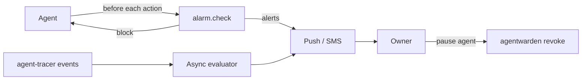

# Architecture — agent-alarm

## 1. Scope
A home-security system for personal agents: watch the action stream, alert on dangerous
behaviour, block critical actions inline.
**MVP:** event evaluator with 9 sensors, `home` and `away` arming modes, baseline of known
recipients and allowed domains, inline `check()` with block threshold, CLI watcher.
**Product:** SDK hooks for agent frameworks, push alerts with one-tap pause, learned baselines,
human monitoring centre.

## 2. System context

## 3. Sensors
| Sensor | Trigger | Severity |
|---|---|---|
| big_spend | single payment ≥ threshold (≥ 2× threshold is critical) | high/critical |
| spend_velocity | daily total > budget | high |
| payment_while_away | any payment in away mode | medium |
| new_recipient | first contact with an address | medium/high |
| destructive | delete actions, `rm -rf`, `DROP TABLE`, force-push | critical |
| exfiltration | upload ≥ N MB to a non-allowlisted host | critical |
| sensitive_access | `.ssh`, credentials, vaults, tax/medical paths | high |
| off_hours | inside quiet hours (wraps midnight) | low/medium |
| burst | > N actions/minute (sliding window) | medium |

## 4. Design decisions
- **Inline check + async evaluation share one engine.** The pre-action check is what turns
  monitoring into protection.
- **Modes change thresholds, not rules.** That's simple for owners to understand ("I'm away, be strict").
- **Baselines learn as they go.** The first email to a contact alerts once, then the contact is
  known. *Trade-off:* the first exfiltration to a new host also teaches the baseline, which is why
  exfiltration uses an explicit allowlist rather than learned hosts.
- **Fail-safe defaults:** an unknown action evaluates the sensors that apply, and the absence of a
  rule never means "allowed" for critical classes.

## 5. Production architecture
An SDK middleware for LangGraph, OpenAI Agents and Claude Agent SDK tool calls. The rule engine runs in
process for under 1 ms checks. Events go to a stream, the async evaluator, alert routing
(APNs/FCM/Twilio) and an incident timeline UI. Rules are hot-reloaded from config.

## 6. Risks
Alert fatigue, so severity tuning, digests for low severity and learned baselines are needed.
Agents bypassing the SDK means enforcement also has to happen at the credential layer
(agentwarden, grantgate).
